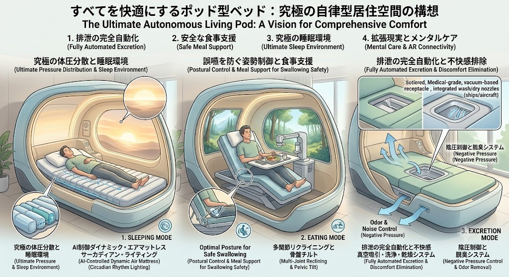

# 未来へ渡るポッド — 200〜1000年コールドスリープ・ベッド構想
**The Future Passage Pod — A 200–1,000-year cold-sleep bed, to be awakened by people of the future**

> 旧構想「一生使える（棺まで）ポッド型ベッド」を発展させたもの。
> 「棺」で終わらせず、**未来人に起こしてもらう「時間の船」**にする。

---

## 1. コンセプト

- 人を **200〜1000年** 保存し、未来の技術で蘇生・治療してもらう
- 保存中は**誰もメンテナンスしなくても壊れない**ことを最優先にする
- 起こす人（未来人）が**言語も文化も違う**前提で、「何者か・どう起こすか・なぜ起こす価値があるか」をポッド自身が伝える
- 目覚めた本人が未来社会に**適応できるまで支える**（旧構想の睡眠・食事・排泄・メンタルケアを「覚醒後のリハビリ」として使う）

## 2. ライフサイクル（5つのフェーズ）

| フェーズ | 内容 |
|---|---|
| ① 入眠 | 医療チームが冷却・保護処置（ガラス化保存など）をして、ポッドに収める |
| ② 長期保存 | 200〜1000年。低温（液体窒素 −196℃級）を保ち、状態を記録し続ける |
| ③ 発見・判断 | 未来人がポッドを見つけ、記録を読み、「起こせるか・起こすべきか」を判断する |
| ④ 覚醒 | 未来の医療で解凍・修復・蘇生する（**現在の技術ではできない**ことを前提にしている） |
| ⑤ 適応 | 寝たまま過ごせるケアモード（睡眠・食事・排泄）＋言葉と社会の学び直し |

## 3. 主な機能

### 3.1 1000年もつ保存システム
- **受動的な断熱**：真空多層断熱で、電気が止まっても温度がすぐ上がらない
- **冷却を何重にも**：液体窒素の自動補給、地中の冷たさ、動く部品の少ない冷凍機。どれか1つが壊れても保てる
- **置き場所**：地下の施設や、岩盤・永久凍土を想定（天災・戦争・放置に強い場所）
- **素材**：数百年もつもの（ステンレス、セラミック、ガラス）。プラスチックはなるべく使わない

### 3.2 未来人へのメッセージ（タイムカプセル機能）
- **言葉に頼らない説明**：図・数字・物理定数（例：水素原子）で「中に生きた人がいる」「起こし方」を描く（核廃棄物の警告表示の研究を参考にする）
- **ロゼッタ・ストーン方式**：同じ内容を多くの言語で刻む
- **長く残る記録媒体**：石英ガラスへのレーザー記録や、金属板への刻印。電気がなくても読める
- **本人の記録**：病歴・DNA・保存処置の手順・保存中の温度記録・本人の声と言葉

### 3.3 状態監視とブラックボックス
- 温度・圧力・振動の記録を、電源なしでも残る形で保存する
- 「この期間に何℃まで上がった」が未来人に分かる → 蘇生できるかの判断材料になる

### 3.4 覚醒後のケア（旧構想を引き継ぐ）
- **睡眠モード**：AIで硬さを変えるエアマットレス、体内時計に合わせた照明
- **食事モード**：誤嚥を防ぐ姿勢の制御と、食事の手伝い
- **排泄モード**：吸引式の自動排泄処理、陰圧で臭いを出さない
- **AR／メンタルケア**：知っている人が誰もいない世界での孤独や、ショックへのケア

### 3.5 「時間の通訳」AI（なんだっけAIとの連携）
- 何百年も眠った本人には、未来の言葉はほとんど**「知らない単語」**
- 「なんだっけAI」の仕組みで、未来の言葉・道具・常識を**本人が分かる言葉で**解説する
- 反対に、本人の時代（21世紀）の言葉や文化を未来人に説明する役もする

## 4. 起こしてもらうための仕組み

未来人が「起こす理由」を持てるようにしておく。

- **財団・信託**：保管費用と、起こす人へのお礼を長期の基金で用意する
- **歴史資料としての価値**：21世紀を生きた人の体・記憶・言葉そのものが、未来の歴史学の資料になる
- **本人の意思表示**：「いつ、どんな条件なら起こしてほしいか」（例：○○病が治せるようになったら）を記録しておく

## 5. 正直な課題（現在の科学で分かっていること）

- **人を凍らせて生き返らせる技術は、今はまだない**。小さな組織や胚では成功例があるが、脳を含む全身ではない
- 今の「クライオニクス（人体冷凍保存）」は、**法的に死亡と認められた後**に処置するしかない。生きたまま眠る形は法律上もできない
- 凍らせるときに組織が壊れる問題（氷の結晶・保存液の毒性・ひび割れ）は未解決
- 1000年は、国家や組織が続くよりはるかに長い期間。**「誰が守り続けるか」**が技術以上に難しい
- 未来人が起こしてくれる保証はない（倫理・法律・人権の扱いも未来しだい）

→ この構想は「今すぐ作るもの」ではなく、**保存・通信・適応の設計を先に考えておく**ための提案です。

## 6. 今後のTODO

- [ ] 既存のクライオニクス団体（Alcor、Cryonics Institute など）の方式を調べる
- [ ] 長期保存できる記録媒体と、言葉に頼らない伝え方を調べる
- [ ] コンセプト画像を新しい仕様に描き直す
- [ ] 特許にできる部分（監視ブラックボックス、未来人向けの伝達方式、覚醒後ケアなど）を整理する

---

## English Summary

A concept pod that preserves a person for **200–1,000 years** and relies on **people of the future** to revive them.
It is designed for **zero-maintenance survival** (passive insulation, redundant cooling, underground siting, durable materials).
It carries a **self-explaining time capsule** (non-linguistic diagrams, multilingual "Rosetta" plates, quartz-glass records, a thermal black box).
After revival, it provides **post-awakening care** (sleep, meals, excretion, AR mental care) and a **"time interpreter" AI** that explains unfamiliar future words and concepts to the sleeper.
Note: reversible whole-body human cryopreservation is **not possible with current technology**. This is a design proposal for preservation, communication, and readaptation.
